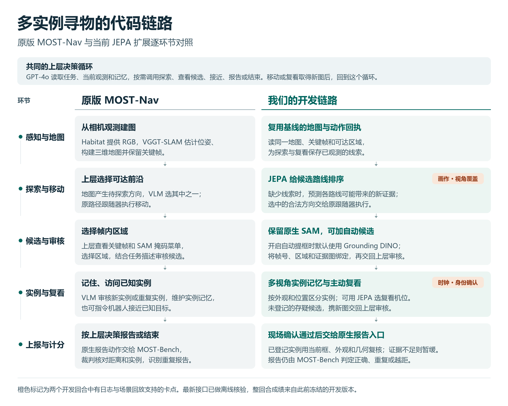

# MOST-Nav 与 JEPA 多实例寻物链路

[可放大的矢量图](architecture.svg)

## 失败发生在什么位置

原版冻结任务中有 118 个回合具备验收记录及可对齐的场景重放。10 个报齐，14 个提前结束且未报齐，94 个用满 300 步仍未报齐。这 94 个回合中，85 个没有进入足够多不同实例的合法报告范围，另有 9 个曾进入足够多实例的范围，最终仍未报齐。按全部 118 例的配额缺口计，缺少的 523 次正确实例报告中，359 次对应未接近足够实例，164 次对应已接近但未报出。进入范围只检验位置，摄像机可能正朝着另一面墙。[冻结原版分项统计](../instance_view_confirmation/budget/native_budget.json)

当前最详细的整机归因来自两个 HM3D 开发回合。两例都用原版的 GPT-4o、起点、任务和计分器。最新候选框与跨视角结果是对已有场景的局部回放。

| 完整回合 | 原版正确报告 / 配额 | 近距复看版正确报告 / 配额 | 复看版最早可定位的缺口 |
|---|---|---|---|
| 时钟 | 1/2，90 步，另有 1 次重复报告 | 0/2，300 步，0 次报告 | 只接近 1 个实例；已接近的实例也未通过复看后的外观确认 |
| 指定彩色风景画 | 0/3，300 步，2 次越距报告 | 0/3，300 步，0 次报告 | 只接近 1 个实例，274 张建图关键帧均未拍到指定画作 |

[原版与开发版完整回合计数](../pose_instance_memory/active_confirmation/results.json)

### 画作：探索位置和朝向没有产生可用的目标图像

机器人首次进入合法报告范围后，在该位置原地转向、俯仰的 13 张仿真图中，指定画作的语义像素仍全为零。另取朝向指定画作的参考机位，在达到可见门槛的 10 张图中，Grounding DINO 的首框命中 9 张，前三框命中 10 张。后者使用目标位置设置相机，衡量的是目标已入镜时的检测能力。对本次漏报，最有价值的改变是让探索策略选一个实际可达、平移后有机会看见新墙面或遮挡背后的观察位，并核对抵达后的图像。[关键帧与朝向目标的对照](../learned_verification/candidates/attribute_controls.json) · [原地扫视](../learned_verification/external/paint_scan_summary.json) · [同图候选统计](../region_proposals/compare/box_results.json)

画作还有独立的候选审核缺口。5 个不同候选都随成功请求送达上层，2 个被明确拒绝，3 个没有有效审核，最终登记 0 个。核对原图，这 5 个候选均来自两个没有指定画作的视角，选到的是墙、门、天花板等区域。把这 3 个候选全部审完，也无法从原图登记正确目标。候选交接能提高送审完整度，不能替代取得新视野。[送审记录与源图核对](../pose_instance_memory/active_confirmation/README.md)

### 时钟：到达、画框、认出同一实例是三次不同的判断

4 次复看中，3 次到达计划视点后返回 `no_current_instance_match`，另 1 次因位姿或目标位置估计改变而结束。17 个复看动作都与执行回执吻合。第一处抵达点已逐像素复核：时钟和前景木台面被赋予同一仿真实例编号，先前的 5.01% 使用该编号的全部像素作为分母；实际钟面对应的 905 个像素里，DINO 框住了 901 个。原生 SAM、DINO 和训练精修三种提框方法用登记图匹配自身均能通过，用靠近后的新图均未通过。由此能将此处漏报定位到跨视角确认；参考图太小、观测尺度差异、背景影响与匹配阈值各贡献了多少，尚未拆开。[复看动作](../pose_instance_memory/active_confirmation/results.json) · [语义与相机对齐](../region_proposals/habitat/alignment_audit.json) · [同图与跨视角对照](../region_proposals/adapter/source_to_live.json)

时钟仍有独立的覆盖问题：本次进入过有效报告范围的不同实例仅有 1 个，配额是 2 个。即使补回上述漏报，该轨迹也最多报对 1 个。两例完整回合中位姿 JEPA 真正参与候选身份评分的次数都是 0，不能把“零重复报告”归功于它。[闭环记录](../pose_instance_memory/active_confirmation/results.json)

### 选路：有得选、选得好、实际走到要分别记录

早期五例中，46 次前沿激活只有 5 次进入 JEPA 评分，4 次选择与原生路线不同，0 次从实际动作核实走到了两条路线的第一个不同动作。之后针对同类交接问题，4 次改道在受控物理回放中均执行到了分岔；在另一版两个完整回合中，9 次选定探索视点仅 1 次到达，7 次实际动作偏离计划，1 次被上层新决策抢占。这些统计分别描述不同版本的探索。时钟近距复看的 17/17 动作核验只适用于复看支路。[早期五例](../most_environment_panel_v13/README.md) · [执行器回放](../most_execution_v14/README.md) · [探索视点记录](../instance_view_confirmation/analysis/view_funnel.json)

在早期五例的灯具任务中，开发版曾进入 2 个实例的合法报告范围，3 次实际报告却均在范围外。镜子任务需 3 个只接近 1 个。这两例的 JEPA 选路评分次数都是 0，不能用它们判定学习出的路线排序好坏。另在 12 栋留出 HSSD 房屋对 430 个查询比较同样三条路线，JEPA 选中的路线在 225 个查询中至少看到一个目标，同输入直接监督为 228 个。两项结果提示，探索需要同时改进备选视角的覆盖、排序目标以及所选路线的实际执行。[逐例重放](../most_environment_panel_v13/outcomes.json) · [选路头同预算比较](../fixed_budget_completion/README.md)

## 当前代码由谁作决定

| 决策 | 代码中的职责 |
|---|---|
| 要探索、接近、审核还是报告 | 原生上层 VLM 和原有控制流程继续负责。探索分支有多个实际可执行的方向时，JEPA 可以改选方向，原跟随器执行。参见[路线接口](../jepa_variable_v16/README.md)。 |
| 图中有哪些候选 | 原版 SAM 给区域编号；启用自动候选时默认使用 DINO。可选的图文筛选只决定优先给上层看哪个框。参见[提框入口](../region_proposals/adapter/provider_agent.py)。 |
| 两次看到的是不是同一物体 | 原版已有实例登记和去重。开发版增加观测图、估计位置、相机位姿和同帧共现约束；满足歧义条件时位姿 JEPA 给近邻身份提示，保留原身份审核。参见[跨视角判重](../pose_instance_memory/report_recovery/pose/README.md)。 |
| 证据不足时下一步去哪看 | 从记忆地图生成可达观察位，验证头预测哪个机位更可能取得局部视觉证据。未登记的存疑候选携实际新图回到上层，已登记实例进入现场复核。参见[主动复看入口](../learned_verification/integration/verify_agent.py)。 |
| 确认证据够不够、报告是否得分 | 现场复核综合当前框、登记外观和几何条件。收到实际报告动作回执后更新记忆；MOST-Bench 独立判定本次是否正确得分。参见[报告恢复与门控](../pose_instance_memory/report_recovery/README.md)。 |

## 对 JEPA 训练的含义

1. **探索训练优先预测“走过去会新增什么目标证据”。** 用同一起点、不同可达路线的真实终点图比较收益。对每条路线分别保留预期视野、是否实际走到、到达时目标是否入镜，才能分清是候选路线没有机会、排序选错，还是运动没有执行到位。画作案例尤其需要能改变可见墙面或绕过遮挡的平移路线。
2. **跨视角确认单独训练和评估。** 正例采用同一实例从远处小图到近景的真实观测，难负例采用同一房间的相似实例与相似背景。比较保留单张和多视角登记图时的真匹配、错认与暂缓。该模块针对时钟漏报；是否采用 JEPA 作匹配器可与同输入的直接监督对照。当前证据支持先改善实例确认，尚不足以确定唯一阈值或网络结构。
